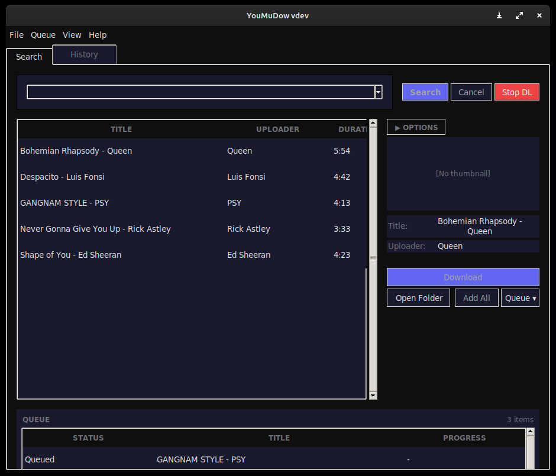

# YouMuDow

[](https://github.com/Ghostalex07/YouMuDow/actions/workflows/ci.yml)
[](https://github.com/Ghostalex07/YouMuDow/releases)


A modern music & video downloader with real-time progress, persistent configuration, and a clean desktop interface. Built on [yt-dlp](https://github.com/yt-dlp/yt-dlp) for support across 1000+ sites.

| Main window | Queue & progress |
|---|---|
|  |  |

## Features

- Search by name or paste any URL (YouTube, SoundCloud, Vimeo, Twitter, ...)
- Playlists and channels: paste a playlist, `@handle` or channel URL and queue
  every entry, loading them in pages of `playlist_limit` (1-500) with
  **Load more** for long playlists
- Download as MP3, M4A, FLAC, WAV, OGG, OPUS, AAC, or MP4
- Download presets ("Music 320", "Video 1080", "Archive FLAC") plus per-format
  options
- Duration and estimated size preview in the detail panel before downloading
- Real-time progress bar and download log
- Cookie authentication (Chrome, Firefox, Edge, Brave, Opera, Vivaldi)
- Rate limiting, chapter splitting, subtitles
- Failed downloads retry automatically with backoff; the pending queue is
  restored on the next start
- Optional system tray: closing the window can keep the queue running (needs a
  status-notifier host on Linux)
- `Help > Export Diagnostics...` writes version, ffmpeg, environment and a
  redacted config into one file for support
- English and Spanish interface, switchable in `View > Language` (automatic by
  default, following your system language); the in-app guide is translated too
- Checks GitHub for a newer release on startup and points you at it
  (`Help > Download Update...`); switch it off with `"check_for_updates": false`
- Built-in user guide: `View > User Guide` (or `F1`) opens a closable tab that
  documents search, playlists, formats, queue, tray and diagnostics
- Light/Dark theme, persistent configuration
- System notifications on completion
- Clipboard URL detection on startup
- `youmudow-cli` for headless downloads and searches
- Cross-platform: Linux, macOS, Windows

## Requirements

- Python 3.10+
- [ffmpeg](https://ffmpeg.org/download.html) (required by yt-dlp for audio conversion)
- tkinter (included with Python on Windows/macOS; install `python3-tk` on Linux)

## Installation

### From source

```bash
git clone https://github.com/Ghostalex07/YouMuDow.git
cd YouMuDow
python3 -m venv .venv && source .venv/bin/activate
pip install -e .
youmudow
```

Linux: `sudo apt install python3-tk` (Debian/Ubuntu) or `sudo dnf install python3-tkinter` (Fedora).

### Download executable

Download the latest release from the [Releases page](https://github.com/Ghostalex07/YouMuDow/releases). ffmpeg must be installed separately.

### ffmpeg

| Platform | Install |
|----------|---------|
| Debian/Ubuntu | `sudo apt install ffmpeg` |
| Fedora | `sudo dnf install ffmpeg` |
| macOS | `brew install ffmpeg` |
| Windows | Download from [ffmpeg.org](https://ffmpeg.org/download.html) and add to PATH |

## Usage

1. Enter a song name or paste a URL
2. Click a result to select it
3. Choose format and quality
4. Click **Download** (or add to queue)
5. Monitor progress in the queue panel

Advanced options: cookies, rate limiting, chapter splitting, and subtitles are available in the detail panel.

## CLI

`youmudow-cli` reuses the same services as the desktop app:

```bash
youmudow-cli download "https://www.youtube.com/watch?v=dQw4w9WgXcQ" --format mp3
youmudow-cli download "bohemian rhapsody" --format mp3 --quality 320kbps
youmudow-cli download "https://..." --output ~/Downloads --skip-metadata
youmudow-cli search "lofi beats" --limit 10
youmudow-cli download "https://www.youtube.com/playlist?list=..." --limit 25
```

Options: `--format`, `--quality`, `--output DIR`, `--skip-metadata`.

For a playlist or channel, `--limit N` sets how many entries to fetch (1-500,
defaulting to `playlist_limit`); the CLI prints `Found N video(s)` and a
`[i/N]` line per entry. Run `youmudow-cli --version` for the version.

## Configuration

Settings live in the OS config directory as JSON:

| File | Contents |
|---|---|
| `config.json` | format, quality, output folder, `playlist_limit`, `max_retries`, `minimize_to_tray`, theme, cookies, search history |
| `queue.json` | the pending queue, restored on the next start |
| `history.json` | download history |
| `youmudow.log` | application log |

On Linux that is `~/.config/youmudow`, on Windows `%APPDATA%\YouMuDow`, on
macOS `~/Library/Application Support/youmudow`. Cookie paths and browser
profiles are never written to `queue.json`.

## Troubleshooting

- **Gatekeeper / SmartScreen warning** — the binaries are not code-signed, so
  macOS and Windows show a first-run prompt. On macOS, right-click the app and
  choose Open once; on Windows, "More info" then "Run anyway".
- **No tray icon on Linux** — the tray needs a status-notifier host (most
  desktops have one; GNOME needs the AppIndicator extension). Without it the
  app logs a line and keeps working normally.
- **Something failed** — `Help > Export Diagnostics...` writes version,
  platform, yt-dlp, ffmpeg, the YouTube environment, a redacted config and the
  last 256 KB of the log into one file you can attach to a report.

## Keyboard Shortcuts

| Shortcut | Action |
|----------|--------|
| `Ctrl+Enter` | Search |
| `Ctrl+D` | Download selected |
| `Ctrl+Q` | Add to queue |
| `Ctrl+L` | Focus search |
| `Escape` | Cancel |
| `Ctrl+T` | Toggle theme |
| `Ctrl+Shift+S` | Start the queue |
| `Delete` | Remove the selected row from the queue |
| `F1` | Open the user guide |

You can also drag a link from your browser onto the window to search it.

## Development

```bash
make install     # pip install -e ".[dev]"
make run         # launch the desktop app
make test        # run tests
make test-ui     # full-stack UI tests (needs a display; uses xvfb-run if present)
make check       # lint + format + typecheck + tests
```

Without `make`:

```bash
pip install -e ".[dev]"
PYTHONPATH=src python3 -m pytest
ruff check src/ tests/
PYTHONPATH=src mypy src/
```

## Building

```bash
pip install pyinstaller
python scripts/build.py          # → dist/YouMuDow
python scripts/package.py        # → dist/YouMuDow-<platform>.zip
python scripts/package.py --version 1.2.0  # → dist/YouMuDow-1.2.0-<platform>.zip
```

The release workflow builds for Linux, Windows, and macOS automatically when you push a version tag.

## Contributing

See [docs/contributing.md](docs/contributing.md) for development setup and how to submit changes.

## License

[MIT](LICENSE)
